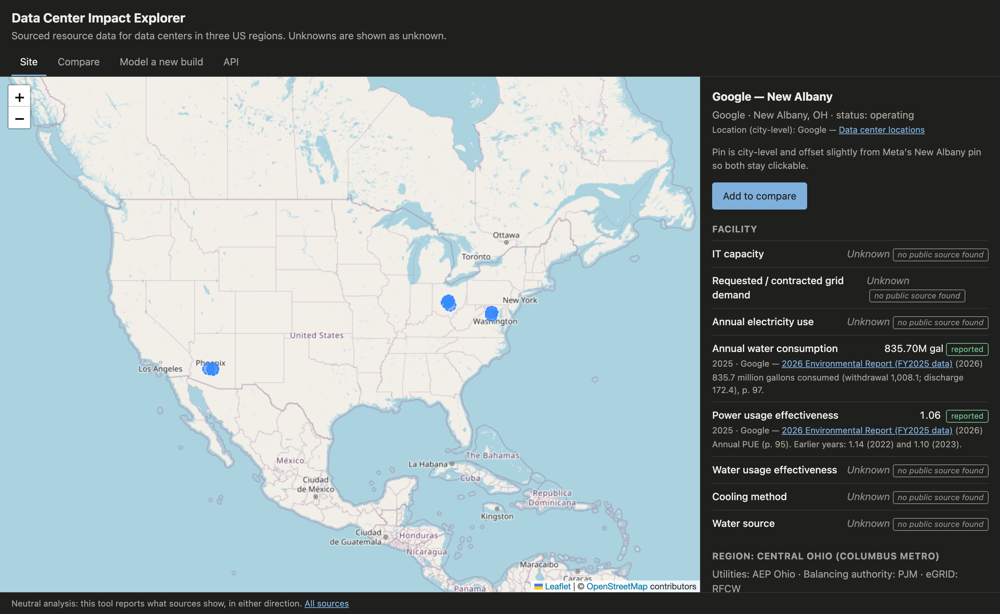

# Data Center Impact Explorer

**Live demo:** https://data-center-impact-explorer.onrender.com · **API docs:** https://data-center-impact-explorer.onrender.com/docs

_Hosted on Render's free tier, so the first load after a quiet spell can take ~30 seconds while it wakes up._

An interactive map of data centers in three US regions — Northern Virginia, Central Ohio, and Phoenix — with their sourced resource data (power, grid carbon intensity, water and cooling, local electricity prices), plus a model for estimating the footprint of a hypothetical new build.



## Principles

- **Neutral analysis, not advocacy.** The tool reports what the data shows, in either direction.
- **Every number carries a source.** A metric without one is shown as **Unknown — not yet sourced**, never filled in. That can mean the figure isn't published, or that it hasn't been found yet.
- **Estimates are labeled as estimates**, with low / central / high bands, and never presented as measurements.

Each value is tagged with one of four kinds:

| Kind | Meaning |
|---|---|
| `measured` | Metered value published by the operator or a regulator |
| `reported` | Figure stated in a filing, permit, report, or government dataset |
| `estimate` | Derived by a stated method from other sourced values |
| `assumption` | Modeling input chosen by the author where no usable source exists |

Sources not yet checked against the original document are flagged **unverified** in the UI.

## How it works

```
data/seed/*.csv      hand-curated: sources, regions, facilities, facts
data/derived/*.csv   generated by scripts/ from EIA and eGRID
        │
        ▼  python -m app.db
data/explorer.db     SQLite build artifact (not committed)
        │
        ▼
app/main.py          FastAPI: /api/facilities, /api/regions, /api/estimate, /api/sources
static/              Leaflet map + Chart.js, plain HTML/JS
```

Facilities and regions hold only identity and location. **Every number lives in one `facts` table**, and the schema requires each fact to reference a source and each estimate or assumption to state its method. A metric with no fact row is returned by the API as `"status": "unknown"`.

## Data sources

| Data | Source | Granularity |
|---|---|---|
| Retail electricity price | [EIA API v2](https://www.eia.gov/opendata/), retail sales (EIA-861M) | State × sector, monthly |
| Grid CO₂ emission rate | [EPA eGRID](https://www.epa.gov/egrid) | eGRID subregion, annual average |
| Facility locations | Operator location pages | City or county level |
| Facility power, water, cooling | Utility filings, permit records, sustainability reports | Per facility, where public |
| Model assumptions (PUE, WUE, utilization) | LBNL 2024 report, Google Environmental Report, Uptime Institute survey | National / industry |

See `/api/sources` for the full list with URLs and access dates.

## Methodology: modeling a new build

```
IT energy (MWh)   = IT capacity (MW) × utilization × 8,760 h
Total energy      = IT energy × PUE
Site water (gal)  = IT energy (kWh) × WUE (L/kWh) ÷ 3.785
CO₂ (t)           = Total energy × grid rate (lb/MWh) ÷ 2,204.6
```

Low and high bands combine the all-low and all-high assumptions, so they are deliberately wide. They show the range the inputs allow, not a statistical confidence interval.

## Limitations

- **Per-facility data is mostly not public.** Many facility metrics show Unknown. Some are unpublished; others are still being researched.
- **Locations are approximate.** Pins are city- or county-level unless a permit gives the site.
- **Prices are statewide averages**, not the tariff a specific utility charges a data center.
- **CO₂ uses the annual average grid rate.** The marginal emissions of a new load can be quite different.
- **Site water only.** Water consumed in generating the electricity (off-site) is not modeled.
- **Three regions only**, by design: depth over coverage.

## Run locally

```bash
python3 -m venv .venv && source .venv/bin/activate
pip install -r requirements-dev.txt
python -m app.db                        # build the SQLite db from CSVs
uvicorn app.main:app --reload           # http://localhost:8000
pytest
```

Refresh public data:

```bash
echo "EIA_API_KEY=your-key" > .env      # git-ignored; free key at eia.gov/opendata
python scripts/fetch_eia_prices.py
# eGRID: download the data .xlsx from https://www.epa.gov/egrid/download-data into data/raw/
python scripts/load_egrid.py data/raw/egrid2023_data_rev2.xlsx 2023
python -m app.db
```

## Adding a sourced fact

Add a row to `data/seed/facts_facility.csv` and, if new, its source to `data/seed/sources.csv`. The build rejects unknown metrics, missing sources, and bands where low > central > high.

## Deploy

`render.yaml` deploys to Render's free tier straight from GitHub: in the Render dashboard choose **New → Blueprint** and pick this repo. The build installs dependencies and rebuilds the SQLite file from the committed CSVs, so no API keys are needed on the server. The free tier sleeps when idle, so the first request can take ~30 s.
